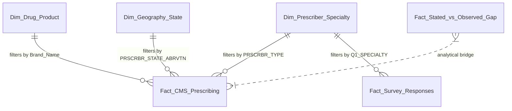

# PharmaPulse Power BI Dashboard Implementation Guide
## Type 2 Diabetes Commercial Analytics & Market Research

This guide provides end-to-end instructions for building and configuring the **PharmaPulse Power BI Dashboard** using the exported CSV datasets and DAX formulas.

---

## 1. Data Model Architecture (Star Schema)

The dashboard uses a standardized Star Schema that isolates transactional fact records from lookup dimensions, maximizing DAX query performance and cross-filtering consistency.

### Table Relationships Configuration

| From Table (Dimension) | From Column | To Table (Fact) | To Column | Cardinality | Cross Filter Direction |
| :--- | :--- | :--- | :--- | :--- | :--- |
| `Dim_Drug_Product` | `Brand_Name` | `Fact_CMS_Prescribing` | `DRUG_NAME` | 1 to Many (`1:*`) | Single |
| `Dim_Prescriber_Specialty` | `Specialty_Name` | `Fact_CMS_Prescribing` | `PRSCRBR_TYPE` | 1 to Many (`1:*`) | Single |
| `Dim_Geography_State` | `State_Code` | `Fact_CMS_Prescribing` | `PRSCRBR_STATE_ABRVTN` | 1 to Many (`1:*`) | Single |
| `Dim_Prescriber_Specialty` | `Specialty_Name` | `Fact_Survey_Responses` | `Q1_SPECIALTY` | 1 to Many (`1:*`) | Both (Bidirectional) |

---

## 2. Step-by-Step Power BI Setup Instructions

### Step 1: Ingest Data Files
1. Open Power BI Desktop.
2. Click **Get Data** > **Text/CSV**.
3. Navigate to `data/processed/powerbi_exports/` and load:
   - `Fact_CMS_Prescribing.csv`
   - `Fact_Survey_Responses.csv`
   - `Fact_Stated_vs_Observed_Gap.csv`
   - `Dim_Drug_Product.csv`
   - `Dim_Prescriber_Specialty.csv`
   - `Dim_Geography_State.csv`
   - `Dim_Barrier_Category.csv`
4. In **Power Query Editor**, ensure numeric columns (`TOT_CLMS`, `TOT_DRUG_CST`, `TOT_BENES`, `COST_PER_CLAIM`) are typed as `Decimal Number` or `Whole Number`. Click **Close & Apply**.

### Step 2: Establish Model Relationships
1. Switch to the **Model View** tab.
2. Drag and drop the relationship keys as specified in the table above.
3. Verify that dimension tables filter fact tables in a 1-to-Many direction.

### Step 3: Add DAX Measures
1. Right-click on `Fact_CMS_Prescribing` and click **New Measure**.
2. Copy and paste measures from `powerbi/DAX_MEASURES.dax`.
3. Format currency measures (`Total Gross Drug Cost`, `Average Cost Per Claim`) as `$#,##0.00`.
4. Format percentage measures (`Claims Share %`, `GLP1 Volume Penetration %`) as `0.0%`.

---

## 3. Dashboard Page Blueprint & Layouts

### Page 1: Executive Overview
*Objective: Provide C-suite leaders with high-level commercial volume, spend, and adoption trends.*

- **Top KPI Cards**:
  - Total Market Claims (`[Total Claims]`)
  - Total Gross Medicare Spend (`[Total Gross Drug Cost]`)
  - Active Prescribers (`[Distinct Active Prescribers]`)
  - GLP-1 Volume Share (`[GLP1 Volume Penetration %]`)
  - Top Barrier Agreement (`[Prior Auth Top-Box %]`)
- **Visual 1 (Donut Chart)**: Claims Share by Drug Class (`Dim_Drug_Product[Drug_Class]` vs `[Claims Share %]`).
- **Visual 2 (Bar Chart)**: Gross Drug Spend by Class vs Volume (`Dim_Drug_Product[Drug_Class]` vs `[Total Gross Drug Cost]` and `[Total Claims]`).
- **Visual 3 (Card Callout)**: Top Market Opportunity summary stating the \$900+ cost hurdle and high stated clinical preference for incretin therapies.
- **Slicers**: Prescriber Specialty (`Dim_Prescriber_Specialty[Specialty_Category]`), Census Region (`Dim_Geography_State[Census_Region]`).

---

### Page 2: Prescribing Landscape
*Objective: Granular exploration of real-world claims across products, specialties, and states.*

- **Visual 1 (Horizontal Clustered Bar Chart)**: Top 10 Prescribed Products by Claims (`Dim_Drug_Product[Brand_Name]` vs `[Total Claims]`).
- **Visual 2 (Choropleth Map / Filled Map)**: State Prescribing Intensity (`Dim_Geography_State[State_Name]` vs `[GLP1 Volume Penetration %]`).
- **Visual 3 (100% Stacked Bar Chart)**: Drug Class Share by Prescriber Specialty (`Dim_Prescriber_Specialty[Specialty_Name]` vs `Dim_Drug_Product[Drug_Class]`, values: `[Total Claims]`).
- **Visual 4 (Scatter Plot)**: Cost per Claim vs Claim Volume (`X: [Total Claims]`, `Y: [Average Cost Per Claim]`, `Details: Brand_Name`).
- **Slicers**: Therapeutic Drug Class (`Dim_Drug_Product[Drug_Class]`), State (`Dim_Geography_State[State_Code]`).

---

### Page 3: Survey Insights
*Objective: Analyze stated physician perceptions, treatment selection drivers, and adoption bottlenecks.*

- **Visual 1 (Horizontal Bar Chart)**: Adoption Barriers Ranked by Severity (`Dim_Barrier_Category[Barrier_Name]` vs Mean Score `[1.0 - 5.0]`).
- **Visual 2 (Column Chart)**: Second-Line ASCVD Treatment Preference (`Fact_Survey_Responses[Q7_SECOND_LINE_ASCVD_PREFERENCE]` vs `% of Total Respondents`).
- **Visual 3 (Matrix / Heatmap)**: Barrier Severity across Specialties (`Rows: Dim_Prescriber_Specialty[Specialty_Name]`, `Columns: Barrier Name`, `Values: Average Score`).
- **Visual 4 (Treemap)**: Primary Clinical Decision Drivers (`Fact_Survey_Responses[Q16_PRIMARY_PRESCRIBING_DRIVER]`).
- **Slicers**: Physician Experience (`Fact_Survey_Responses[Q2_YEARS_EXPERIENCE]`), Practice Setting (`Fact_Survey_Responses[Q3_PRACTICE_SETTING]`).

---

### Page 4: Commercial Opportunities & Stated-vs-Observed Gap
*Objective: Synthesize the gap between clinical intent and real-world execution into actionable initiatives.*

- **Visual 1 (Dumbbell / Grouped Column Chart)**: Stated Clinical Preference % vs Observed Part D Claims % by Drug Class (`Fact_Stated_vs_Observed_Gap`).
- **Visual 2 (Table Visual)**: Market Status, Adoption Gap (pts), Realization Ratio, and Primary Commercial Driver by Drug Class.
- **Visual 3 (Card / Text Matrix)**: Priority Strategic Initiatives (P1: Digital ePA Hub, P1: Medicare Copay Foundation Bridge, P2: Specialty-Tailored Field Force).
- **Visual 4 (Gauge Chart)**: GLP-1 Realization Ratio (`Current Value: [Adoption Realization Ratio]`, Target: 1.0).

---

## 4. Visual Formatting & Design Standards

- **Primary Brand Palette**:
  - Deep Navy Blue (Corporate Accent): `#1E3A8A`
  - Cerulean Blue (Active Brand): `#0284C7`
  - Emerald Green (Positive / Favorable): `#10B981`
  - Amber / Coral (Hurdle / Barrier): `#F59E0B`
  - Crimson (Critical Gap / Drop-off): `#EF4444`
  - Light Slate (Background Cards): `#F8FAFC`
- **Typography**: Segoe UI, DIN, or Arial. Font size hierarchy:
  - Page Titles: 20pt Bold
  - Visual Titles: 12pt Semi-Bold
  - KPI Callout Values: 26pt Bold
  - Data Labels: 9pt Regular
- **Interaction & Drill-Through**:
  - Enable cross-highlighting across all charts on Pages 2 and 3.
  - Configure drill-through from `Dim_Drug_Product[Drug_Class]` on Page 1 directly to Page 2 filtered for that class.
